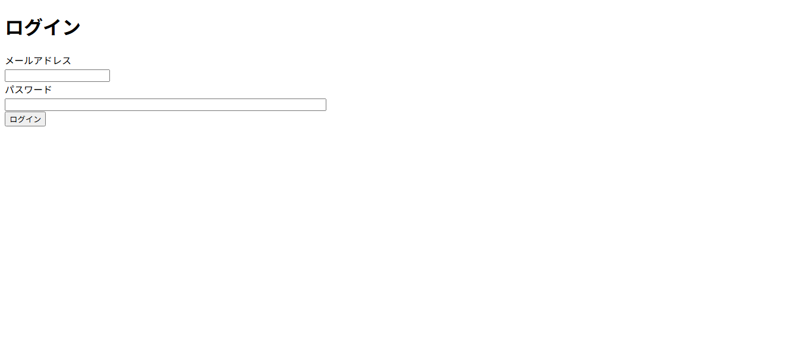
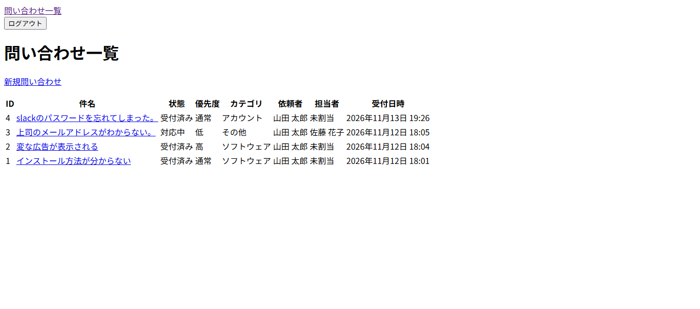
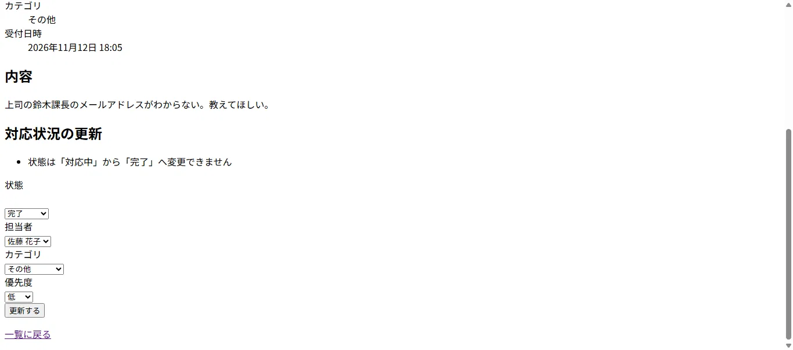
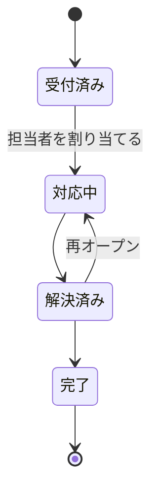
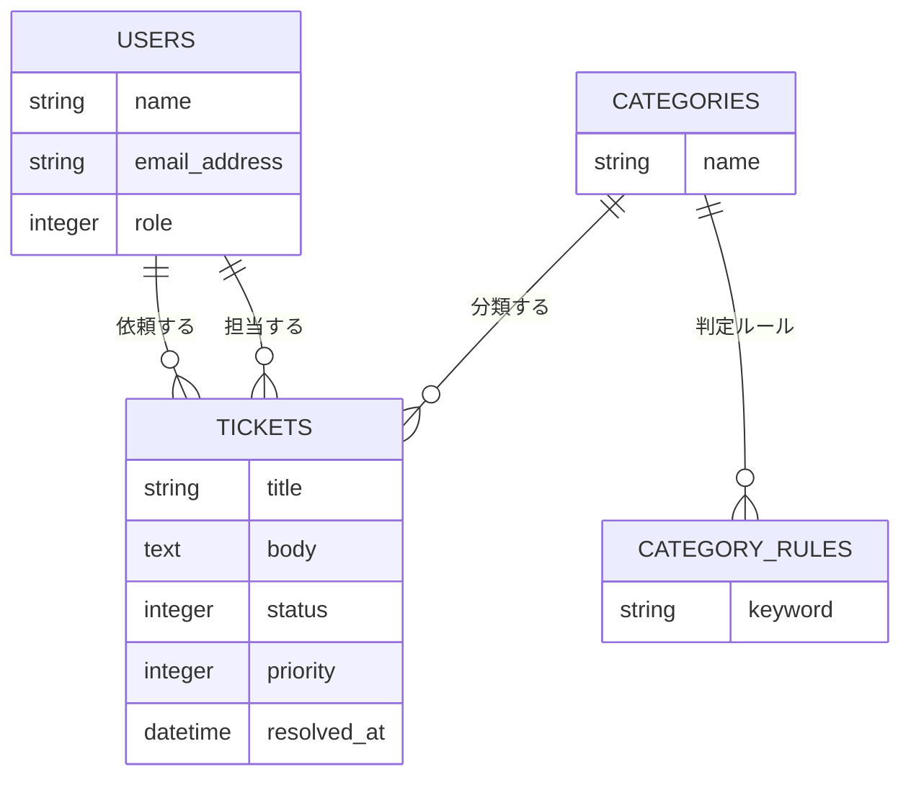

# IT問い合わせ管理アプリ(it-helpdesk)

[](https://dl.circleci.com/status-badge/redirect/gh/ono02-alt/it-helpdesk/tree/main)

社内のIT問い合わせ(パスワード忘れ、PCの不調など)を受け付けて、IT担当者が対応状況を管理するWebアプリです。
問い合わせの内容から**カテゴリを自動で振り分ける**ことで、受付時の仕分け作業を減らします。

未経験からIT業界を目指す学習の成果物として作成しました。
モデル、権限、画面の順に、**先にテストを書き、失敗を確認してから実装する**進め方をとっています。

## 画面

| ログイン | 問い合わせ一覧(IT担当者) |
|---|---|
|  |  |

| 詳細と更新フォーム(IT担当者) | 許可されない状態変更 |
|---|---|
|  |  |

## 主な機能

- ログイン、ログアウト(Rails 8標準の認証)
- 問い合わせの登録、一覧、詳細
- ロール別の権限(一般社員、IT担当者、管理者)
- IT担当者の対応機能: 状態の変更、担当者の割当、カテゴリと優先度の変更
- 状態の遷移ルール(許可されない変更はエラー)
- キーワードによるカテゴリの自動分類
- 日本語表示と日本時間

## 権限

| 操作 | 一般社員 | IT担当者 | 管理者 |
|---|---|---|---|
| 一覧、新規登録 | ○ | ○ | ○ |
| 詳細の閲覧 | 自分の問い合わせのみ | 全件 | 全件 |
| 状態変更、担当者割当、カテゴリ変更 | × | ○ | ○ |

一覧に表示される範囲も、同じルールです。一般社員は自分の分だけが表示されます。

## 状態の遷移



## カテゴリの自動分類

問い合わせの件名と本文から、登録されたキーワードに一致したカテゴリを選びます。

1. 一致したキーワードが**多い**カテゴリを優先する
2. 同数なら、**先に登録されたルール**のカテゴリを選ぶ
3. どれにも一致しなければ「その他」にする

IT担当者は、あとから手動でカテゴリを変更できます。

## データ構造



## 技術構成

| 分類 | 内容 |
|---|---|
| 言語、フレームワーク | Ruby 3.4、Ruby on Rails 8.1 |
| データベース | PostgreSQL 17 |
| 開発環境 | Docker、Docker Compose |
| 認可 | Pundit |
| テスト | RSpec、FactoryBot、Shoulda Matchers |
| CI | CircleCI(テスト、セキュリティ検査、コードの書き方の検査を並行して実行) |
| 静的解析 | RuboCop(rubocop-rails-omakase)、Brakeman、Bundler Audit |

## テストとCI

- RSpecで、モデル、ポリシー、自動分類のクラス、画面へのアクセス(リクエスト)をテストしています。
- CircleCIで、プッシュのたびに、RSpec、Brakeman(セキュリティの静的解析)、Bundler Audit(使っているgemの脆弱性の検査)、RuboCopを自動で実行します。
- 現時点で、Brakemanの警告は0件、Bundler Auditで見つかった脆弱性も0件です。

## 設計の判断記録

1. **権限の判定をPunditのポリシーに集約した**: 画面やコントローラーに条件分岐を散らさず、ルールをポリシーにまとめ、ポリシー単体のテストで固定しました。
2. **他人の問い合わせは、403ではなく404にした**: 見えない問い合わせは「存在しない」ものとして扱い、IDを順番に試して存在を探られるのを防ぎます。更新の権限がない場合は、403にしています。
3. **依頼者は、画面の入力ではなく、ログイン中のユーザーにした**: 他人になりすまして登録できないことを、テストで確認しています。
4. **状態の遷移ルールをモデルに持たせた**: 画面を経由しなくてもルールが守られます。許可される遷移と、されない遷移を、テストで網羅しています。
5. **enumに`validate: true`を付けた**: 不正な値が来ても例外で止まらず、入力エラーとして扱います。
6. **自動分類のキーワードをデータベースに置いた**: コードを変えずに、ルールを増やせます。単純な部分一致のため、たとえば「ネット」は「インターネット」にも一致する、という限界があります。
7. **データベースの接続先を、`DATABASE_URL`ではなく個別の環境変数にした**: テストの実行時に、開発用のデータベースを書き換えてしまう事故を避けるためです。
8. **使わないgem(image_processing)を外した**: CIで、手元とは環境が違い、画像処理のライブラリで失敗しました。原因を特定し、使っていない依存を外して解消しました。
9. **日本語化は、rails-i18nと翻訳ファイルにまとめた**: 状態や優先度の表示名は、翻訳ファイルで一元管理しています。

## 起動方法

Docker(Docker Desktop)が必要です。

```bash
git clone https://github.com/ono02-alt/it-helpdesk.git
cd it-helpdesk
docker compose build
docker compose run --rm web bin/rails db:create db:schema:load db:seed
docker compose up
```

ブラウザで `http://localhost:3000` を開きます。

### デモ用のアカウント(開発環境のみ)

| ロール | メールアドレス | パスワード |
|---|---|---|
| 一般社員 | employee@example.com | password123 |
| IT担当者 | staff@example.com | password123 |
| 管理者 | admin@example.com | password123 |

これらは、開発環境の`db:seed`でだけ作られるデモ用のデータです。

### テストと検査

```bash
docker compose run --rm web bundle exec rspec
docker compose run --rm web bin/rubocop
docker compose run --rm web bin/brakeman --no-pager
docker compose run --rm web bin/bundler-audit
```

## 今後の予定

- 関連FAQの表示(自動分類したカテゴリと同じ、公開済みのFAQを表示)
- コメントと、IT担当者だけが見られる内部メモ
- カテゴリの判定ルールを管理する画面
- 画面のデザイン
- 本番環境へのデプロイ

## 現時点の制限

- パスワードのリセットは、メール送信の設定をしていないため、未対応です。
- 本番環境へのデプロイは、未実施です。
